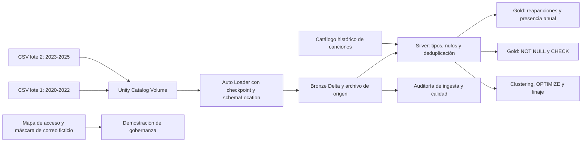

# Vigencia musical en Billboard

Proyecto final del módulo 4 del Técnico en Ingeniería de Datos con Databricks.

Pregunta: ¿qué canciones con debut registrado en el Hot 100 durante los años 80 y 90 reaparecen entre 2020 y 2025, cuánto permanecen y qué posiciones alcanzan?

Fuente pública: [Billboard Hot 100 & more](https://www.kaggle.com/datasets/ludmin/billboard), Godefroy Lambert (ludmin), versión 179. Los datos derivados se atribuyen a esa fuente y conservan su licencia CC BY-NC-SA 4.0.

La primera aparición en un ranking no equivale a la fecha de lanzamiento. El proyecto conserva esa distinción y no interpreta posiciones como reproducciones.

El desarrollo incluye la ingesta incremental, limpieza, resultados analíticos, calidad, gobernanza, orquestación y observabilidad. Se documentará la asistencia de un agente externo como actividad O9 adicional, sin sustituir componentes por decisión del estudiante.

## Arquitectura

El Job ejecuta `bronze → silver → gold → governance → observability`, sobre serverless. Bronze tiene un reintento configurado. Un disparador por llegada de archivos observa la carpeta `charts`. Los checkpoints y el catálogo se guardan fuera de esa carpeta.

## Datos y decisiones

- 31.400 filas de Hot 100 de 2020-2025, en dos lotes de 15.700. Se conserva todo el chart para no seleccionar solamente clásicos.
- 32.694 identidades de título y crédito de artista, extraídas de la historia de la versión 179.
- Grano: una canción acreditada en una fecha de Hot 100. Llave de negocio: `(chart_id, chart_date, song_id)`.
- `song_id` es un hash conservador del título y crédito con espacios exteriores recortados. No es un identificador ISRC y no fusiona automáticamente covers, remixes o variantes de crédito.
- Las fechas textuales del proveedor se preservan. Deben verificarse frente a Billboard antes de atribuir un cambio a un evento en un día concreto.
- `first_hot100_decade` es década de debut observado. `original_release_year` solo está completado en dos ejemplos con fuentes verificadas. Los demás permanecen NULL.
- Se comparan seis años completos, evitando un 2026 parcial.
- `share_chart_entries` mide fracción de puestos semanales observados. No es cuota de streams ni de oyentes.
- Los datos de música son reales según la fuente. Solo la tabla `governance.reviewers_demo` y las inserciones rechazadas de prueba son ficticias y están identificadas como tales.

El ZIP [data/dataset_musica_billboard.zip](data/dataset_musica_billboard.zip) contiene CSV, diccionario, manifiesto con SHA256 y una explicación del dataset. La validación local verifica las huellas y la integridad de las llaves.

## Componentes de la consigna

| Requisito | Implementación | Evidencia a mostrar |
|---|---|---|
| V1 | Auto Loader, Delta, schemaLocation, checkpoint, source_file | `audit.ingestion_runs` y conteos por lote |
| V2 | Casts seguros, NULL, cuarentena, deduplicación, join | `audit.quality_metrics` y notebook 02 |
| C1 | Vistas gold y tabla con NOT NULL/CHECK | Ranking provisional y `audit.quality_rejections` |
| C2 | Job con cinco tareas y dependencias, reintento y trigger | Corrida completa exitosa y configuración |
| C3 | Catálogo por capas, lector limitado, tabla de mapeo, máscara y tags | SHOW GRANTS y outputs de la máscara |
| C4 | Git folder, rama, PR integrado y bundle dev/prod | GitHub, Actions y carpeta Git en Databricks |
| C5 | Consulta a system.access.table_lineage y liquid clustering | OPTIMIZE, DESCRIBE DETAIL e HISTORY |
| O9 adicional | Agente externo operando Databricks CLI | [Bitácora](docs/AGENTE_O9.md) |

El grupo `musica_lectores_uc` es un grupo de cuenta vacío. Tiene uso del catálogo y esquemas gold/governance y SELECT sobre objetos concretos; no recibe MODIFY ni permisos sobre bronze/silver o la tabla de mapeo. Los permisos son acumulativos: probar con el propietario no demuestra las limitaciones de un lector real. La máscara se verifica cambiando la fila de mapeo del usuario de demostración y restaurándola en un bloque `finally`. La verificación con una segunda identidad no se declara realizada.

Los tags `classification=sensitive_demo` y `synthetic=true` dejan claro que la columna de correo es una demostración. No se presenta el nombre público de un artista como dato confidencial.

## Cómo ejecutar

Requisitos: Databricks CLI autenticado, workspace con Unity Catalog y serverless, catálogo con Default Storage y grupo de cuenta `musica_lectores_uc` creado por un administrador. No guardar tokens en este repositorio.

1. Descargar o clonar el repositorio y ejecutar `python scripts/validate_project.py`.
2. Crear el catálogo `musica_saenz` desde Catalog Explorer con Default Storage si aún no existe. Crear esquema `bronze` y volume administrado `landing`. Para dev usar `dev_bronze`, y posteriormente sus otras capas con prefijo `dev_`.
3. Subir únicamente el primer lote y el catálogo: `python scripts/upload_batch.py --batch 1`.
4. Validar y desplegar: `databricks bundle validate -t prod`, luego `databricks bundle deploy -t prod`.
5. Ejecutar el Job: `databricks bundle run -t prod music_pipeline`. Revisar la auditoría: 15.700 filas.
6. Subir el segundo lote con `python scripts/upload_batch.py --batch 2` y ejecutar nuevamente. Esperado: 31.400 filas.
7. Ejecutar sin archivos nuevos. Esperado: `rows_added=0`, total 31.400. No borrar checkpoints para repetir esta prueba.
8. El target dev usa prefijo `dev_`; el target prod usa los esquemas sin prefijo. Validar dev con `databricks bundle validate -t dev`. Para desplegarlo se deben preparar sus carpetas de entrada y cargar sus datos por separado.

La configuración del trigger puede mantenerse pausada durante el montaje inicial y activarse después. Si ya está activa, la llegada del segundo archivo puede disparar la corrida automáticamente; verificar la lista de runs antes de iniciar otra. Las reejecuciones son seguras para la ingesta, pero agregan registros reales a las tablas de auditoría.

El bundle es la fuente de configuración del Job. Cambiar `databricks.yml` y volver a desplegar para modificarlo. No editar a mano los notebooks publicados dentro de `.bundle`.

## Interpretación y defensa

La tabla provisional identifica ocho candidatas, entre ellas Running Up That Hill, Thriller y Fast Car. Se deben verificar los años de lanzamiento faltantes antes de presentar una clasificación definitiva por década de publicación. La fuente y las reglas del Hot 100 limitan la representatividad del resultado.

Para comparar si las canciones nuevas duran menos, haría falta igualar las ventanas de seguimiento de las cohortes y considerar cambios de elegibilidad del chart. No basta con comparar clásicos sobrevivientes con lanzamientos nuevos.

[Guion de presentación y preguntas de práctica](docs/GUION_PRESENTACION.md).

## Licencia y atribución

Datos de Billboard Hot 100 & more: Godefroy Lambert (ludmin), Kaggle, versión 179, consulta del 14 de octubre de 2026. Adaptaciones: selección temporal, dos lotes, identificadores, catálogo derivado y controles de calidad. [CC BY-NC-SA 4.0](https://creativecommons.org/licenses/by-nc-sa/4.0/). El paquete derivado conserva esa licencia y atribución. El código y la documentación de este proyecto académico se ofrecen bajo la misma licencia.

Fuentes de los dos años originales completados: [Kate Bush, canal oficial](https://www.youtube.com/watch?v=wp43OdtAAkM) y [Michael Jackson, álbum Thriller](https://www.michaeljackson.com/albums/thriller/).
