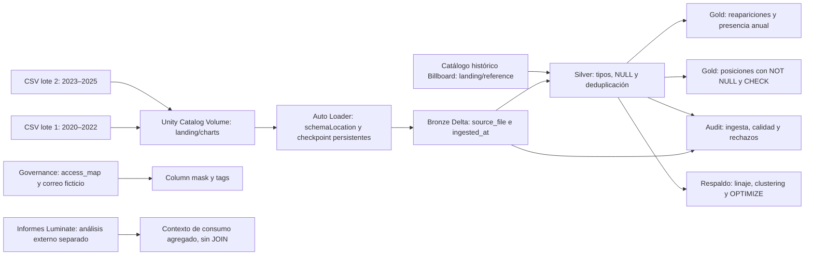
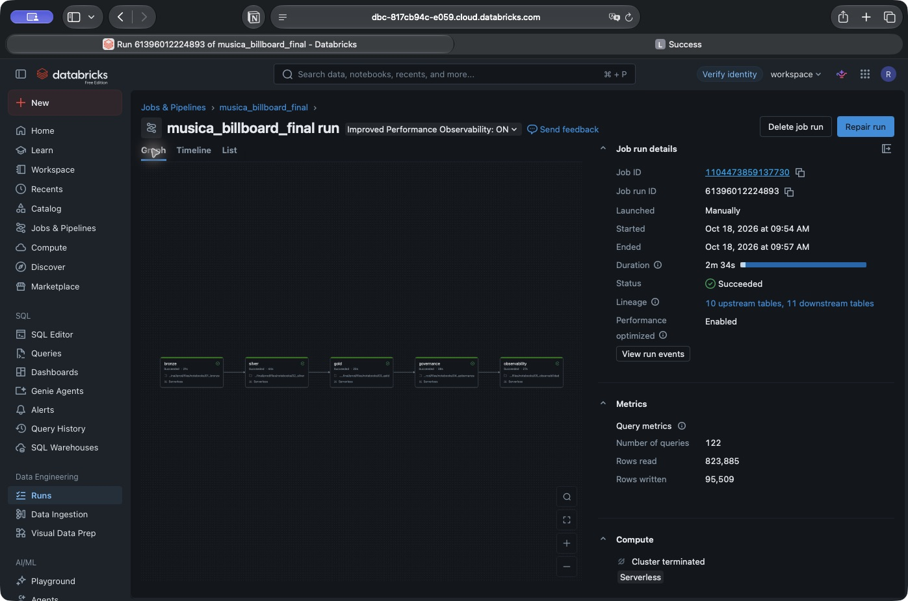
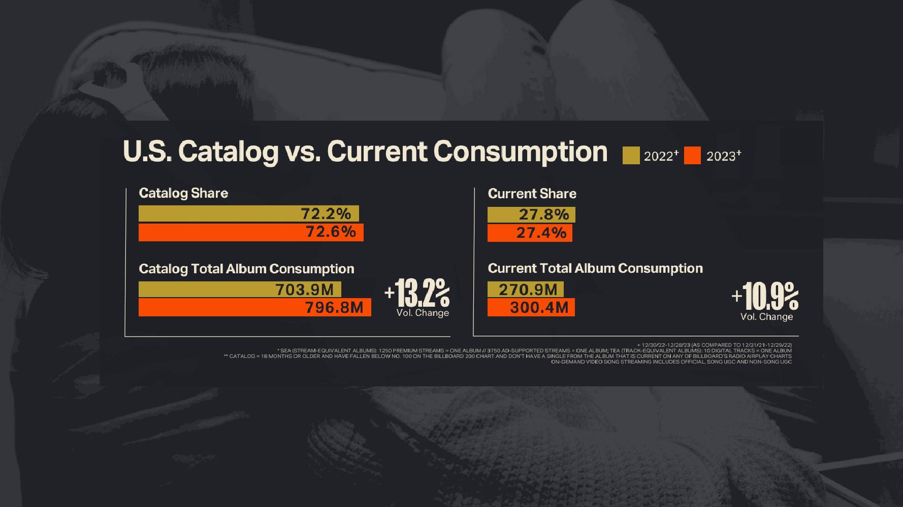

# Vigencia musical: de los archivos a una respuesta defendible

Proyecto final del módulo 4 del Técnico en Ingeniería de Datos con Databricks, Universidad Latina de Costa Rica. **¿Qué canciones con debut observado en el Hot 100 de los ochenta y noventa reaparecen entre 2020 y 2025, cuántas semanas aparecen y qué posiciones alcanzan?**

Este README es el recorrido de la defensa: primero la pregunta, después cómo se construye una respuesta confiable y, al final, qué podemos concluir. **Ruta elegida: V1/V2 + C1, C2, C3, C4 y O9 en reemplazo de C5.** O9 ocupa uno de los cinco componentes; no suma un sexto.

**Antes de empezar:** compartir el [repositorio público](https://github.com/richiemellow/musica-billboard-databricks), abrir la [segunda corrida completa](https://dbc-817cb94c-e059.cloud.databricks.com/?o=7474649418788750#job/1104473859137730/run/759442763674218) y sus tareas, el Git folder y el [PR #1 integrado](https://github.com/richiemellow/musica-billboard-databricks/pull/1). Las [consultas de lectura](https://github.com/richiemellow/musica-billboard-databricks/blob/docs/defensa-o9-reemplaza-c5/docs/demo_lectura.sql) permiten mostrar resultados sin insertar pruebas ni cambiar permisos.

Los enlaces a Databricks provienen de `run_page_url` en [job_runs.json](evidence/job_runs.json) y requieren acceso al workspace. Son evidencia de ejecuciones del **18 de octubre de 2026**, no una comprobación en vivo de esta sesión. Desde cada corrida, seleccionar la tarea indicada para abrir su notebook y salida. Los `.py` de GitHub muestran código, no outputs. No se localizaron enlaces verificados a consultas guardadas o dashboards; los `statement_id` de los JSON identifican consultas ejecutadas, no dashboards ni enlaces públicos.

| Tramo | Tiempo acumulado | Qué debe quedar demostrado |
|---|---|---|
| [1. Pregunta y fuentes](#1-pregunta-y-fuentes) | 0:00–1:30 | Qué mide cada fuente |
| [2. Arquitectura](#2-arquitectura) | 1:30–2:30 | Recorrido de ingesta a Gold |
| [3. Bronze · V1](#3-bronze--v1) | 2:30–4:30 | Dos lotes, cada uno una vez |
| [4. Silver · V2](#4-silver--v2) | 4:30–6:30 | Tipos, nulos, deduplicación, join y métricas |
| [5. Gold y calidad · C1](#5-gold-y-calidad--c1) | 6:30–9:00 | Respuesta y rechazo real de filas inválidas |
| [6. Orquestación · C2](#6-orquestación--c2) | 9:00–10:30 | DAG, reintento, trigger y corrida exitosa |
| [7. Gobernanza · C3](#7-gobernanza--c3) | 10:30–12:30 | Grants, mapeo, máscara y tags |
| [8. Código y despliegue · C4](#8-código-y-despliegue--c4) | 12:30–14:00 | Git folder, rama y PR integrado |
| [9. Trabajo con agente · O9](#9-trabajo-con-agente--o9) | 14:00–15:30 | Solicitud, trabajo y corrección |
| [10. Conclusión y aprendizaje](#10-conclusión-y-aprendizaje) | 15:30–17:30 | Alcance de la respuesta y contexto Luminate |

El plan incluye navegación y deja **2 min 30 s de margen** hasta el máximo de 20 minutos. Los anexos quedan para preguntas. Según *M4-proyecto-final.pdf*, pp. 8–9, un componente que no se muestra cuenta como ausente: el README acompaña la demostración con outputs visibles.

## 1. Pregunta y fuentes

> Quise investigar la vigencia de la música. Para responder con estos datos, tuve que precisar qué significa “seguir vigente”: aquí observo presencia en un ranking semanal. Una posición no me dice cuántas veces se escuchó una canción.

El pipeline usa [Billboard Hot 100 & more](https://www.kaggle.com/datasets/ludmin/billboard), de Godefroy Lambert / ludmin, **versión 179**, consultada el 14 de octubre de 2026. Selecciona todas las entradas Hot 100 de 2020–2025: **31.400 filas**, en dos lotes cronológicos de 15.700. Conservar el chart completo da un denominador reproducible; seleccionar solo clásicos lo sesgaría. El catálogo histórico contiene **32.694 identidades** de título y crédito de artista.

**Grano:** una canción acreditada en una fecha del Hot 100. **Llave:** `(chart_id, chart_date, song_id)`. `song_id` es un hash conservador de título y crédito con espacios exteriores recortados; no es un ISRC y no fusiona automáticamente covers, remixes ni variantes de crédito. El [ZIP del dataset](data/dataset_musica_billboard.zip) incluye CSV, diccionario, procedencia, licencia y manifiesto SHA-256.

La primera aparición registrada no equivale al lanzamiento. `first_hot100_decade` clasifica el **debut observado**; `original_release_year` solo está completado para dos ejemplos verificados. Las fechas textuales del proveedor se conservan: antes de atribuir un reingreso a un evento de un día específico, habría que contrastarlas con Billboard.

Luminate aporta después **consumo agregado estadounidense**, con unidades equivalentes y definiciones por informe. **No hay JOIN entre Billboard y Luminate.** El único join del pipeline en Silver es con el catálogo histórico derivado de Billboard. La ampliación histórica calculada localmente y los informes Luminate no forman parte de las tablas Gold de este repositorio.

**Mostrar:** la pregunta, la fuente y la llave; no abrir todavía los anexos analíticos.

## 2. Arquitectura

> La respuesta pasa por tres capas. Bronze conserva lo que llegó y su procedencia; Silver lo tipa y valida; Gold responde la pregunta. Las auditorías permiten revisar qué ocurrió en cada ejecución.



El catálogo `musica_saenz` contiene esquemas `bronze`, `silver`, `gold`, `audit` y `governance`, definidos en [00_config.py](notebooks/00_config.py). El Job serverless ejecuta `bronze → silver → gold → governance → observability`; [databricks.yml](databricks.yml) declara esas dependencias. Los archivos de referencia y el estado están fuera de `charts`, para que el trigger observe solo entradas de datos.

**Mostrar:** diagrama y capas en Catalog Explorer. **Evidencia faltante:** no hay aquí una captura independiente del catálogo completo; abrirlo en el workspace para la demostración.

## 3. Bronze · V1

> Aquí se ve Auto Loader. `schemaLocation` guarda información del esquema y el checkpoint conserva el progreso. Por eso agregar el segundo lote incorpora datos nuevos, pero volver a correr sin archivos nuevos no duplica Bronze.

**Abrir:** [notebook 01, código](notebooks/01_bronze.py); para sus outputs, entrar a la [corrida sin archivos nuevos](https://dbc-817cb94c-e059.cloud.databricks.com/?o=7474649418788750#job/1104473859137730/run/61396012224893) y seleccionar **bronze**. Localizar `spark.readStream.format('cloudFiles')`, `cloudFiles.schemaLocation`, `checkpointLocation`, `_metadata.file_path` como `source_file` y `trigger(availableNow=True).toTable(target)`.

La auditoría exportada registra:

| Corrida | Antes | Después | Nuevas |
|---|---:|---:|---:|
| Primer lote | 0 | 15.700 | 15.700 |
| Segundo lote | 15.700 | 31.400 | 15.700 |
| Sin archivos nuevos | 31.400 | 31.400 | 0 |

Fuente: [ingestion_runs.json](evidence/ingestion_runs.json), campos `rows_before`, `rows_after`, `rows_added`. [batch_counts.json](evidence/batch_counts.json) confirma **15.700 filas y un archivo distinto por lote**. Ambos conservan SQL, `statement_id`, estado y resultados. Mostrar consultas **1–2** de [demo_lectura.sql](https://github.com/richiemellow/musica-billboard-databricks/blob/docs/defensa-o9-reemplaza-c5/docs/demo_lectura.sql).



La captura demuestra el estado del Job; **el cero de filas nuevas se demuestra con la auditoría**, no con la imagen. No se borran checkpoints ni se renombran archivos para repetir la prueba. La idempotencia demostrada corresponde a la ingesta Bronze: Silver se reconstruye y las auditorías agregan registros en cada ejecución.

**Evidencia faltante:** la exportación no incluye el conteo explícito de `source_file IS NULL`; la consulta 2 lo verifica al presentarla. No se declara aquí un resultado obtenido hoy.

## 4. Silver · V2

> Conservar archivos no basta: necesito fechas y posiciones con sus tipos correctos, una regla para los ausentes y una llave que no multiplique canciones al enriquecerlas.

**Abrir:** [notebook 02](notebooks/02_silver.py), o tarea **silver** de la [segunda corrida](https://dbc-817cb94c-e059.cloud.databricks.com/?o=7474649418788750#job/1104473859137730/run/759442763674218). Mostrar `typed`, `valid`, `Window.partitionBy(*keys)`, `dedup.join(metadata,'song_id','left')` y la salida final de métricas; consultas **3–4** del [recorrido SQL](https://github.com/richiemellow/musica-billboard-databricks/blob/docs/defensa-o9-reemplaza-c5/docs/demo_lectura.sql).

| Decisión | Por qué | Resultado exportado |
|---|---|---|
| `try_cast` a fecha y enteros; trim de textos | Una conversión inválida debe poder detectarse | 31.400 filas Bronze → 31.400 Silver |
| Posición previa ausente → NULL | Cero no es una posición válida | 4.899 ausentes antes y 4.899 NULL después |
| Campos obligatorios inválidos → cuarentena | Evitar que contaminen resultados | 0 filas en cuarentena |
| Deduplicar por chart, fecha y canción | Una identidad cuenta una vez por fecha | 0 duplicados retirados |
| Join izquierdo con catálogo único por `song_id` | Enriquecer sin expandir ni perder hechos | 0 filas sin catálogo; cardinalidad comprobada |

Evidencia: [silver_quality.json](evidence/silver_quality.json). **Cero duplicados retirados significa que estos lotes no tenían duplicados de negocio**; no demuestra una prueba adversarial. Los años de lanzamiento desconocidos permanecen NULL: la métrica de **31.373** cuenta filas de hechos, no canciones distintas.

Silver se reconstruye desde Bronze completo porque el volumen es pequeño; un pipeline grande requeriría evaluar una estrategia incremental. Las aserciones de unicidad y cardinalidad protegen este join; en Gold veremos restricciones que hace cumplir el motor Delta.

## 5. Gold y calidad · C1

> Ahora sí puedo responder la pregunta original. La vista encuentra ocho candidatas por década de debut observado. Las semanas son fechas distintas presentes en 2020–2025, aunque haya salidas y reingresos; no son necesariamente semanas consecutivas.

**Abrir:** [notebook 03](notebooks/03_gold.py), tarea **gold** de la [segunda corrida](https://dbc-817cb94c-e059.cloud.databricks.com/?o=7474649418788750#job/1104473859137730/run/759442763674218); mostrar `classic_comebacks` y consultas **5–7** de [demo_lectura.sql](https://github.com/richiemellow/musica-billboard-databricks/blob/docs/defensa-o9-reemplaza-c5/docs/demo_lectura.sql).

| Canción y crédito | Semanas observadas | Mejor puesto |
|---|---:|---:|
| Running Up That Hill (A Deal With God) — Kate Bush | 20 | 3 |
| Thriller — Michael Jackson | 7 | 10 |
| Ghostbusters — Ray Parker Jr. | 5 | 22 |
| Still D.R.E. — Dr. Dre Featuring Snoop Dogg | 3 | 23 |
| Somebody's Watching Me — Rockwell | 3 | 24 |
| "Mama, I'm Coming Home" — Ozzy Osbourne | 2 | 48 |
| Ruff Ryders' Anthem — DMX | 1 | 16 |
| Fast Car — Tracy Chapman | 1 | 42 |

Fuente exacta: [classics.json](evidence/classics.json), `weeks_observed` y `best_rank`. Es un resultado **provisional por debut**, no una lista exhaustiva por año de publicación. `annual_presence` calcula `share_chart_entries`: fracción de puestos semanales observados, **no cuota de streams ni de oyentes**. No se conserva aquí una exportación independiente de esa vista; mostrar su output en el notebook si se comenta.

> Además de responder, necesito demostrar calidad aplicada. En `gold.validated_positions`, Delta impone NOT NULL y un CHECK de rango 1–100. Una fila inválida no entra aunque intente insertarla.

Extractos **literales** guardados el 18 de octubre a las 15:55:50.598 UTC en [rejected_rows.json](evidence/rejected_rows.json), filas `rank_fuera_de_rango` y `song_id_nulo`:

```text
[DELTA_VIOLATE_CONSTRAINT_WITH_VALUES] CHECK constraint valid_rank between(rank, 1, 100) violated by row with values:
 - rank : 101.

[DELTA_NOT_NULL_CONSTRAINT_VIOLATED] NOT NULL constraint violated for column: song_id.
```

[table_properties.json](evidence/table_properties.json) conserva el CHECK; [not_null_columns.json](evidence/not_null_columns.json) muestra `is_nullable=NO` para las tres columnas. Las pruebas son sintéticas y separadas del análisis musical. El error completo está en `audit.quality_rejections` y en los outputs; los JSON publicados omiten la traza JVM. El ensayo anterior `rank_nulo` produjo un error de CHECK: para demostrar NOT NULL se usa explícitamente `song_id_nulo`.

## 6. Orquestación · C2

> El Job hace que cada etapa espere a la anterior. Si Bronze falla, Silver no debe consumir una ingesta incompleta. Bronze tiene un reintento configurado; el trigger observa la llegada de archivos.

**Abrir:** [corrida 759442763674218](https://dbc-817cb94c-e059.cloud.databricks.com/?o=7474649418788750#job/1104473859137730/run/759442763674218). Mostrar el DAG de cinco tareas, estado **SUCCESS** y configuración del Job `1104473859137730`. [job_configuration.json](evidence/job_configuration.json) registra un reintento en Bronze, intervalo de 60.000 ms y trigger `file_arrival`, `UNPAUSED`, sobre `/Volumes/musica_saenz/bronze/landing/charts/`.


Las tres validaciones fueron **manuales**. Tener trigger configurado no prueba que disparara estas corridas; reparar Gold tampoco prueba el reintento automático de Bronze. La [primera corrida](https://dbc-817cb94c-e059.cloud.databricks.com/?o=7474649418788750#job/1104473859137730/run/319200698253743) terminó correctamente después de reparaciones, conservadas en [job_runs.json](evidence/job_runs.json). Su [captura original](evidence/01_primera_corrida.png) queda como respaldo para O9. No hace falta iniciar otra ejecución durante la exposición.

## 7. Gobernanza · C3

> El lector necesita consultar resultados, no modificar el pipeline. Para mostrar una columna protegida sin inventar datos privados de artistas, separé una tabla de revisores con un correo ficticio. La máscara es real y consulta una tabla de mapeo.

**Abrir:** [notebook 04](notebooks/04_gobernanza.py), tarea **governance** de la [tercera corrida](https://dbc-817cb94c-e059.cloud.databricks.com/?o=7474649418788750#job/1104473859137730/run/61396012224893); mostrar consultas **8–11** del [recorrido SQL](https://github.com/richiemellow/musica-billboard-databricks/blob/docs/defensa-o9-reemplaza-c5/docs/demo_lectura.sql).

**Estos son los resultados guardados de la prueba del 18 de octubre de 2026.** No hace falta interpretar JSON para leerlos; los enlaces a esos archivos quedan como respaldo.

**Primero: qué puede consultar el lector.**

| Perfil | Permiso observado | Objeto | Qué significa |
|---|---|---|---|
| `musica_lectores_uc` | `USE CATALOG` | `musica_saenz` | Puede usar el catálogo |
| `musica_lectores_uc` | `USE SCHEMA` | `musica_saenz.gold` | Puede usar el esquema Gold |
| `musica_lectores_uc` | `SELECT` | `gold.validated_positions` | Puede consultar esa tabla |
| `musica_lectores_uc` | `SELECT` | `governance.reviewers_demo` | Puede consultar la tabla de demostración |

Cada fila transcribe una salida de `SHOW GRANTS`: [catálogo](evidence/reader_catalog_grants.json), [Gold](evidence/reader_gold_grants.json), [tabla validada](evidence/reader_table_grants.json) y [tabla demo](evidence/reader_demo_grants.json). No es un inventario exhaustivo de todos los permisos del workspace. El grupo de cuenta está vacío; no recibe MODIFY ni permisos directos sobre Bronze/Silver o el mapa. Se conserva `BROWSE` heredado de `account users`: permite descubrir metadatos, no leer filas por sí solo.

**Después: qué hace la máscara con el correo.**

> Si mi autorización dice que no puedo ver el correo, la consulta devuelve `[oculto]`. Si me autoriza, devuelve el correo ficticio. La consulta funciona en ambos casos: ocultar el dato no es un error.

| Autorización del mapa durante la prueba | Resultado observado en la consulta |
|---|---|
| Sin autorización (`mapping_false`) | `[oculto]` |
| Con autorización (`mapping_true`) | `revision.musica@example.invalid` |

Fuente: [mask_validation.json](evidence/mask_validation.json), campo `rows`, registros de `2026-10-18T15:56:23.152Z`. El notebook 04 conecta `governance.access_map` con la función `mask_reviewer_email` mediante `SET MASK`. Cambió el mapeo de **la misma identidad**, comprobó ambos resultados y lo restauró con `finally`. **No se probó una segunda identidad y no se reclama O2.** Los permisos son acumulativos: probar como propietario no demuestra el acceso efectivo de otro lector.

**Para mostrar esos dos resultados en Databricks**, abrir SQL Editor o una celda SQL y ejecutar esta consulta de lectura. Consulta la evidencia histórica; no vuelve a cambiar la autorización:

```sql
SELECT observed_at, scenario, observed_value
FROM musica_saenz.audit.mask_validation
ORDER BY observed_at, scenario;
```

Para consultar la tabla protegida con la autorización **actual**, usar:

```sql
SELECT *
FROM musica_saenz.governance.reviewers_demo;
```

Son dos consultas diferentes: la primera recupera la prueba guardada; la segunda aplica la máscara al consultar ahora. Como la prueba restauró la autorización al terminar, ver el correo completo puede ser correcto. No se ejecutaron estas consultas de nuevo al redactar esta sección.

**Finalmente: cómo se identifica la columna de demostración.**

| Columna | Etiqueta | Valor guardado |
|---|---|---|
| `governance.reviewers_demo.reviewer_email` | `classification` | `sensitive_demo` |
| `governance.reviewers_demo.reviewer_email` | `synthetic` | `true` |

Fuente: [demo_tags.json](evidence/demo_tags.json). Las etiquetas identifican el carácter sensible de la demostración y que el dato es ficticio; la función de máscara controla lo que devuelve la consulta.

**Dónde abrir cada cosa:** GitHub muestra código y resultados exportados; no ejecuta SQL. El [recorrido SQL de esta revisión](https://github.com/richiemellow/musica-billboard-databricks/blob/docs/defensa-o9-reemplaza-c5/docs/demo_lectura.sql) contiene las consultas 8–11 para usar en Databricks. Si se abre el mismo archivo bajo `main` antes de integrar el PR #2, puede aparecer una página de archivo inexistente: eso no es una prueba del enmascarado. Los errores de filas inválidas corresponden a **C1**, sección 5.

No hay captura específica de estos outputs en el repo. Las tablas anteriores transcriben resultados exportados, no capturas ni una nueva ejecución. En la defensa, abrir la tarea **governance** de la corrida enlazada para mostrar la salida del notebook.

## 8. Código y despliegue · C4

> El código y la configuración tienen historia revisable. El Git folder conecta el workspace con GitHub; el bundle declara el Job y sus ambientes. La validación automática revisa archivos, pero no despliega a Databricks.

**Mostrar, en este orden:** Git folder en Databricks con remoto `richiemellow/musica-billboard-databricks`; rama y estado actual; [PR #1, MERGED](https://github.com/richiemellow/musica-billboard-databricks/pull/1), desde `feature/pipeline-musica` hacia `main`; [bundle](databricks.yml), targets `dev`/`prod`; [workflow de validación](.github/workflows/validate.yml) y [Actions](https://github.com/richiemellow/musica-billboard-databricks/actions).

El merge original está en el commit `e99146b`. `prod` es el despliegue de las corridas mostradas; `dev` tiene prefijo `dev_` y no se declara desplegado. Esta revisión narrativa se prepara en el [PR #2](https://github.com/richiemellow/musica-billboard-databricks/pull/2), pendiente de revisión; **no reemplaza al PR #1 como evidencia de integración**.

**Evidencia pendiente de mostrar en vivo:** conexión y rama actuales del Git folder, y estado de Actions. No hay una captura verificada de esas pantallas en el repositorio. Tener un remoto local no sustituye mostrar el Git folder conectado que pide C4.

## 9. Trabajo con agente · O9

> Elegí O9 en reemplazo de C5. Pedí al agente investigar las fuentes, preparar el dataset y ejecutar el laboratorio usando Databricks CLI. El agente escribió y ejecutó el código; mi responsabilidad es revisar y explicar las decisiones y los límites.

**Mostrar:** [bitácora completa](docs/AGENTE_O9.md), [notebook Gold](notebooks/03_gold.py), [primera corrida con sus intentos](evidence/job_runs.json) y [PR de implementación](https://github.com/richiemellow/musica-billboard-databricks/pull/1).

| Solicitud y trabajo | Corrección concreta | Resultado comprobable |
|---|---|---|
| Preparar y ejecutar el pipeline con CLI | La definición inicial de CHECK falló; el agente pasó a `ALTER TABLE ... ADD CONSTRAINT` y comprobó su existencia para permitir reejecuciones | Primera corrida reparada; las posteriores rechazan `rank=101` y `song_id=NULL` |
| Diseñar la identificación musical | Separar debut observado de lanzamiento; dejar años desconocidos NULL | Campos y estados de verificación en `classics.json` |
| Mostrar gobernanza | Usar grupo de cuenta y correo sintético separado | Grants, máscara y tags exportados |

No atribuyo al estudiante una edición manual que hizo el agente. La bitácora documenta petición, trabajo y correcciones; no hay una transcripción íntegra de comandos/chat publicada en este repo. Linaje y optimización siguen implementados como respaldo, sin reclamar C5 como sexto componente ni afirmar que Silver sea la tabla más grande.

## 10. Conclusión y aprendizaje

> El resultado principal es un pipeline trazable que encuentra ocho reapariciones candidatas según el debut observado. Puedo explicar de dónde sale cada cifra y mostrar las reglas que rechazan datos inválidos. Eso todavía no mide la vida completa de escucha de una canción.

Para situar esa pregunta, Luminate ofrece contexto **externo**, sin unir sus registros al ranking:

| Consumo estadounidense | 2021 | 2022 | 2023 |
|---|---:|---:|---:|
| Participación de catálogo | 69,8% | 72,2% | 72,6% |
| Música reciente: millones de unidades equivalentes de álbum | 269,5 | 270,9 | 300,4 |

Fuentes: [informe Luminate 2022, p. 7](https://luminatedata.com/wp-content/uploads/2023/01/Luminate_US-YearEndReport_2022_FINAL_1.pdf#page=7) e [informe 2023, p. 13](https://luminatedata.com/wp-content/uploads/2024/01/Luminate_Year-End_Report_2023.pdf#page=13). Los períodos, definiciones y ubicaciones están en el [CSV transcrito](evidence/luminate/luminate_catalog_series.csv). **Catálogo gana 2,8 puntos porcentuales entre 2021 y 2023, mientras el volumen reciente también crece.** Perder cuota no significa perder volumen.



El [respaldo visual de 2022, p. 7](evidence/luminate/luminate_2022_p7.png) muestra 2021–2022. Ambas imágenes fueron inspeccionadas y copiadas sin modificar desde el paquete de defensa disponible; no son capturas nuevas de Databricks. La definición de esos informes incluye 18 meses de antigüedad y condiciones de chart/airplay. **Catálogo no equivale exclusivamente a clásicos de los ochenta y noventa.** El CSV conserva otra base para 2023–2024 (72,7% y 73,3%); no se empalma con 72,6% ni se promedia, por las diferencias metodológicas y de períodos.

> Para el examen aprendí a distinguir checkpoint de esquema, reglas Delta de aserciones, permisos configurados de acceso efectivo y dependencias de ejecución de control de versiones. Para estudiar vida de escucha necesitaría consumo por canción y semana, grabaciones validadas y ventanas de seguimiento comparables.

No se concluye que las canciones nuevas duren menos a partir de las ocho candidatas sobrevivientes. Tampoco se atribuyen causas a nostalgia, redes o cambios de gusto: no se midieron. **Fin del recorrido principal: 17 min 30 s previstos.**

<details>
<summary>Anexo A · Cobertura de la rúbrica y evidencias pendientes</summary>

Referencia revisada: *M4-proyecto-final.pdf*, diez páginas, docente Andrés Calvo Vargas. Mínimos de V1/V2 en p. 3; C1–C5 en p. 4; opcionales en pp. 5–6; README y presentación en pp. 8–9. El archivo se consultó en el material local del curso y no se añade al repositorio público.

| Peso dentro del proyecto | Requisito elegido | Dónde se muestra |
|---|---|---|
| 25% | V1/V2 obligatorios | Secciones 3–4: dos lotes, procedencia, tipos, NULL, deduplicación, join y métricas |
| 9% | C1 | Sección 5: objeto Gold, NOT NULL/CHECK y errores literales |
| 9% | C2 | Sección 6: cinco tareas, dependencias, reintento, trigger y SUCCESS |
| 9% | C3 | Sección 7: capas, grants, column mask con mapa y tags |
| 9% | C4 | Sección 8: Git folder, rama y PR integrado; bundle recomendado |
| 9% | O9 → C5 | Sección 9: petición, trabajo y corrección del agente |
| 10% | README y diagrama | Problema/fuente, arquitectura, elecciones, decisiones y ejecución |
| 20% | Presentación y defensa | Mostrar outputs en vivo, ≤20 min y responder pregunta del examen |

Las exportaciones respaldan ejecuciones previas; no certifican el estado actual ni una nota. Antes de presentar faltan confirmar los outputs visibles del workspace, abrir Catalog Explorer y Git folder, comprobar Actions y ensayar el recorrido cronometrado. No existe una grabación del ensayo. La captura del Job no sustituye los resultados de celdas de calidad o gobernanza.

No se localizaron enlaces verificados a notebooks individuales para todas las tareas ni a queries guardadas/dashboard. Se usan las corridas reales y los nombres exactos de tarea para navegar, con JSON y código como respaldo. Los `statement_id` se conservan dentro de cada exportación.

Segunda identidad, trigger efectivamente disparado y despliegue dev **no se declaran demostrados**; tampoco se presentan como mínimos adicionales de la ruta elegida. No hay inventario comparativo de tamaños que pruebe cuál es la tabla mayor para C5.

</details>

<details>
<summary>Anexo B · Cómo ejecutar y reproducir las comprobaciones</summary>

Requisitos: Databricks CLI autenticado, workspace con Unity Catalog/serverless, catálogo con Default Storage y grupo de cuenta `musica_lectores_uc` creado por un administrador. No guardar tokens en el repositorio. Ejecutar desde la raíz del repo (en este proyecto local, `laboratorio_musica/`).

1. Validar archivos y dataset: `python scripts/validate_project.py` y exportaciones: `python scripts/validate_evidence.py`. Son comprobaciones locales; no vuelven a ejecutar Databricks.
2. Si no existe, crear `musica_saenz` desde Catalog Explorer con Default Storage; crear esquema `bronze` y volume administrado `landing`.
3. Cargar solo lote 1 y catálogo: `python scripts/upload_batch.py --batch 1`.
4. Validar y desplegar: `databricks bundle validate -t prod`, después `databricks bundle deploy -t prod`.
5. Ejecutar `databricks bundle run -t prod music_pipeline`; comprobar 15.700 filas en auditoría.
6. Cargar `python scripts/upload_batch.py --batch 2`; ejecutar y comprobar total 31.400.
7. Ejecutar sin archivos nuevos; comprobar `rows_added=0`, total 31.400. No borrar checkpoints.
8. Para dev, preparar esquema `dev_bronze` y su volume, usar `--schema-prefix dev_` al cargar, y validar/desplegar con `-t dev`. Tiene datos y estado separados; no se afirma que este despliegue ya exista.

La secuencia de dos lotes describe un montaje nuevo. Si ya existen los archivos o el estado, no se espera volver a ver 0→15.700. El script no sobrescribe archivos existentes. El trigger puede pausarse durante el montaje y activarse después: si está activo, revisar los runs antes de lanzar otro manualmente. Las reejecuciones agregan auditoría.

El bundle es la fuente de configuración: modificarlo y redesplegar para cambiar el Job. No editar notebooks publicados dentro de `.bundle`. [Decisiones y límites](docs/DECISIONES.md); [preguntas de práctica](docs/GUION_PRESENTACION.md).

</details>

<details>
<summary>Anexo C · Respaldo de observabilidad y optimización</summary>

[Notebook 05](notebooks/05_observabilidad.py): consulta `system.access.table_lineage`, `OPTIMIZE`, `DESCRIBE DETAIL` e `HISTORY`. Evidencia exportada: [linaje real](evidence/system_lineage.json), [clustering por fecha y canción](evidence/clustering.json) e [historial de OPTIMIZE](evidence/table_history.json). Abrir tarea **observability** de la segunda corrida para outputs.

No se afirma una mejora de rendimiento sin benchmark, ni que Silver sea la tabla más grande sin inventario. Este trabajo queda fuera de los cinco componentes elegidos porque O9 reemplaza C5.

</details>

## Licencia y atribución

Datos Billboard: Godefroy Lambert (ludmin), Kaggle, versión 179; [CC BY-NC-SA 4.0](https://creativecommons.org/licenses/by-nc-sa/4.0/). Adaptaciones: selección temporal, lotes, identificadores, catálogo derivado y controles de calidad. El paquete derivado conserva atribución y licencia; código y documentación propios se ofrecen bajo la misma licencia.

Años originales completados: [Kate Bush, canal oficial](https://www.youtube.com/watch?v=wp43OdtAAkM), 1985; [Michael Jackson, álbum Thriller](https://www.michaeljackson.com/albums/thriller/), 1982. Debut y publicación permanecen en campos distintos.

Las imágenes y cifras Luminate se atribuyen a sus informes oficiales 2022/2023 y conservan sus derechos; no se relicencian como datos propios del proyecto. [Procedencia y límites de esa evidencia](evidence/luminate/PROCEDENCIA.md).
